# Preview v0.2.0 — visual refinement

Screenshots of the refined build (production build run locally, development-seed data). Not a hosted preview.
Desktop 1440×900, mobile 390×844 (2× scale). Compare with [v0.1.0](../v0.1.0/README.md).

> The dashboard rules are unverified development placeholders. Do not treat them as real requirements.

## What changed (no new colours, gradients, rounded cards or motifs)
- **Type scale**: display type reduced ~18% on landing and functional screens. Questionnaire untouched.
- **One condensed headline per section/screen**; secondary headings use a calmer normal-width bold (`.heading`).
- **Accent used as status, not fill**: vendor tiles are plain, with a small "Needed" indicator; the final landing CTA moved to the ink background; "Save your plan" and "Request received" no longer fill with accent.
- **Border hierarchy**: 2px for primary (next action, critical items, sample card), 1px hairline for secondary (categories, required items, vendor tiles), whitespace plus a bottom rule for tertiary (recommended items, requests, notes).
- **Dashboard**: readiness number ~20% smaller, structured date/time/location row, category progress as one hairline strip, timeline without boxes.
- **Empty states**: deadlines, vendor requests, My plans, check results and "all done" now explain what's missing and what to do.
- **Preparation pack**: contents ledger, then paper sheets on a quiet backdrop with document headers, hairline tables and a footer carrying the disclaimer.

| Screen | Desktop | Mobile |
|---|---|---|
| Landing hero | 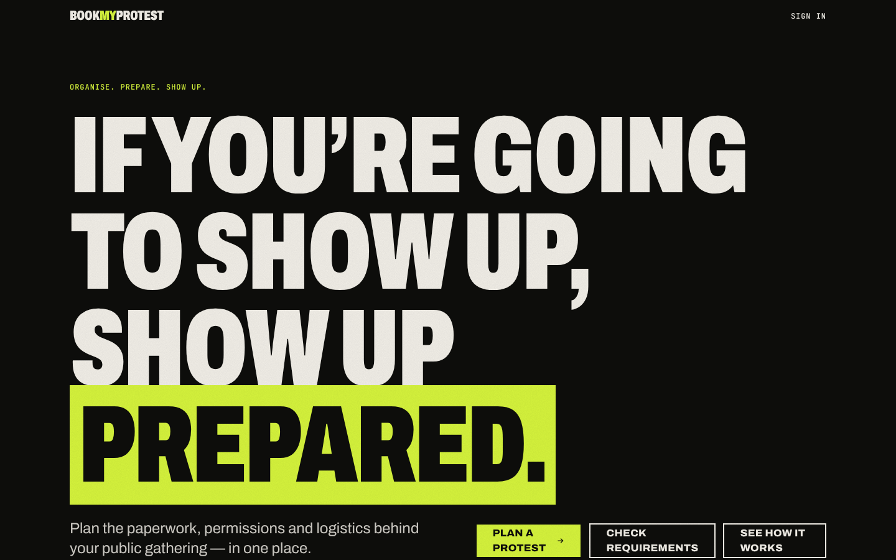 | 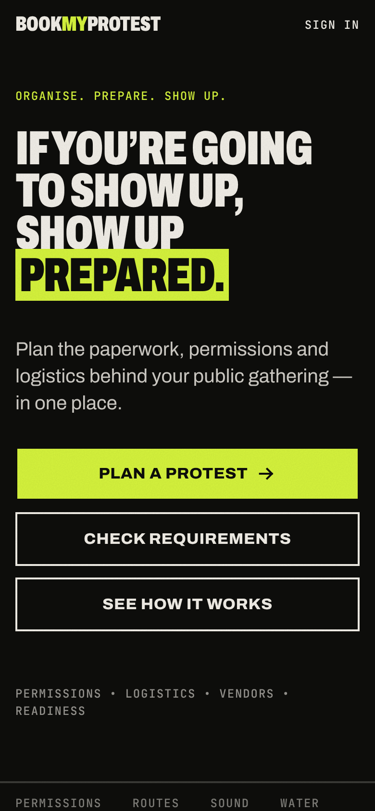 |
| Sample readiness card | 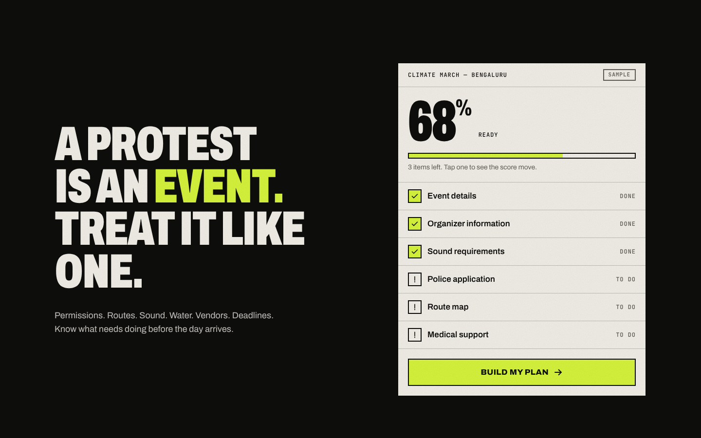 | 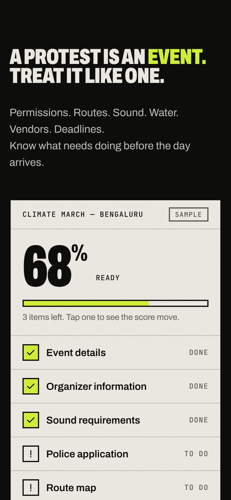 |
| Questionnaire | 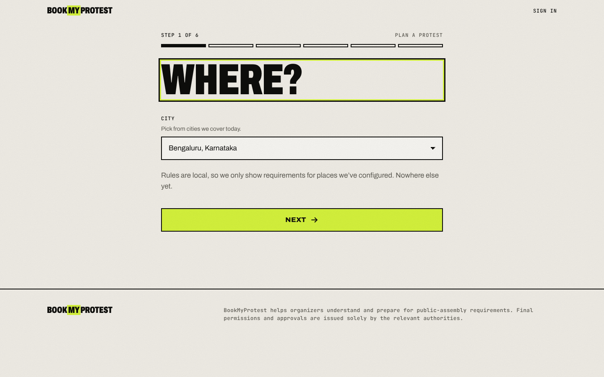 |  |
| Dashboard | 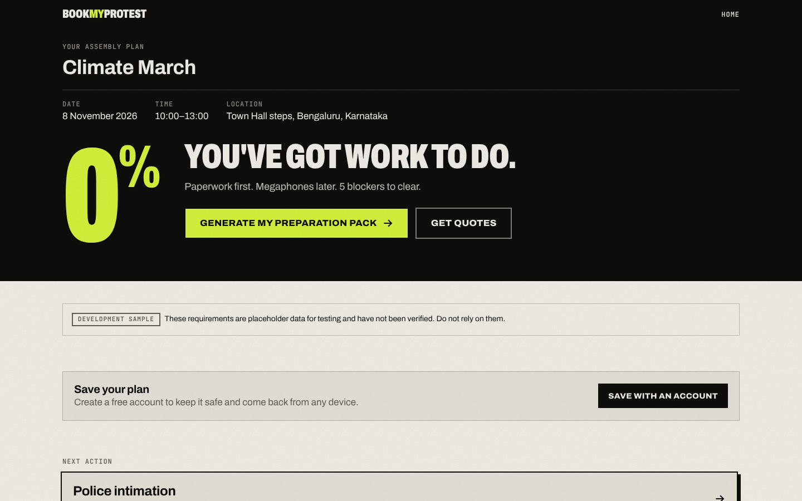 | 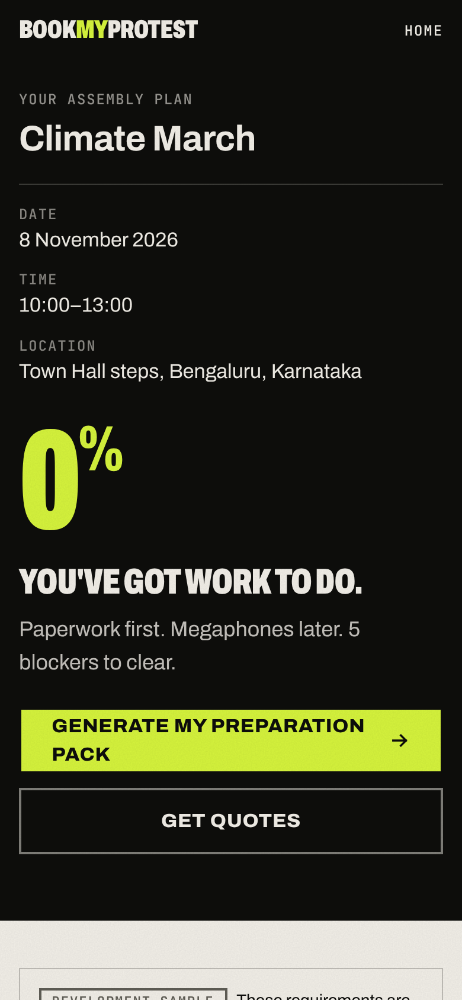 |
| Dashboard requirements | 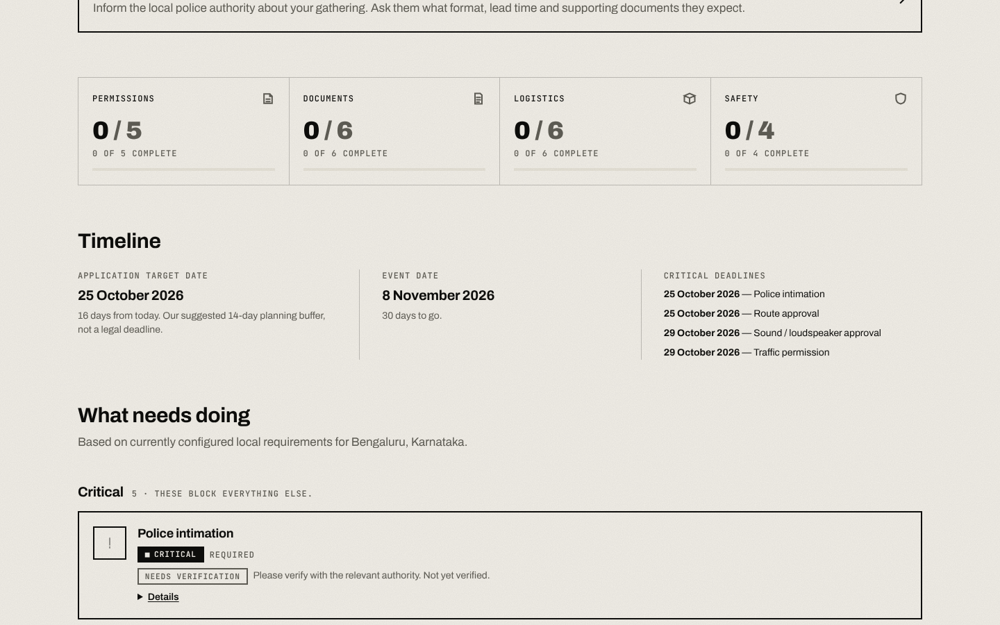 | 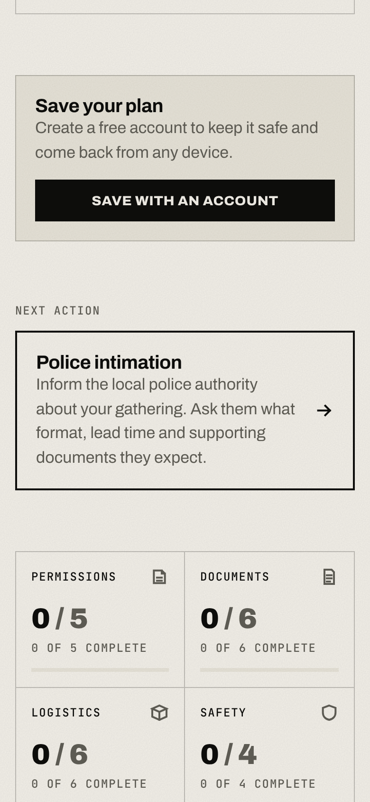 |
| Vendors | 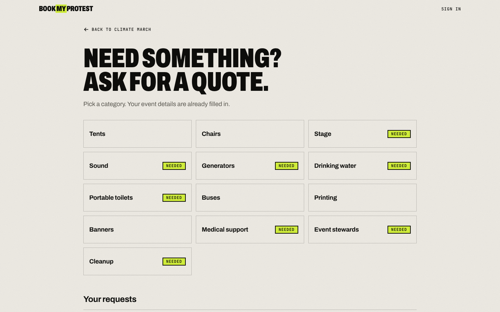 | 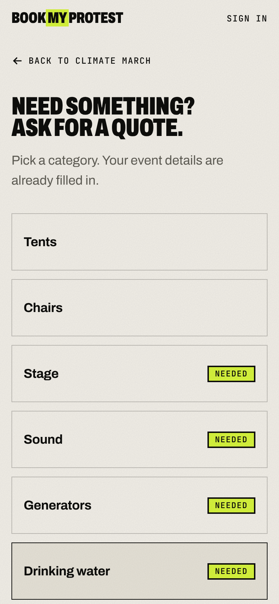 |
| Preparation pack | 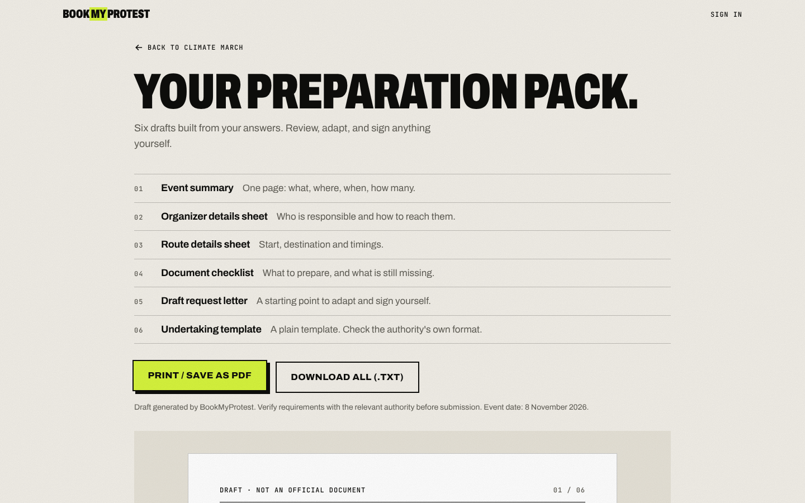 | 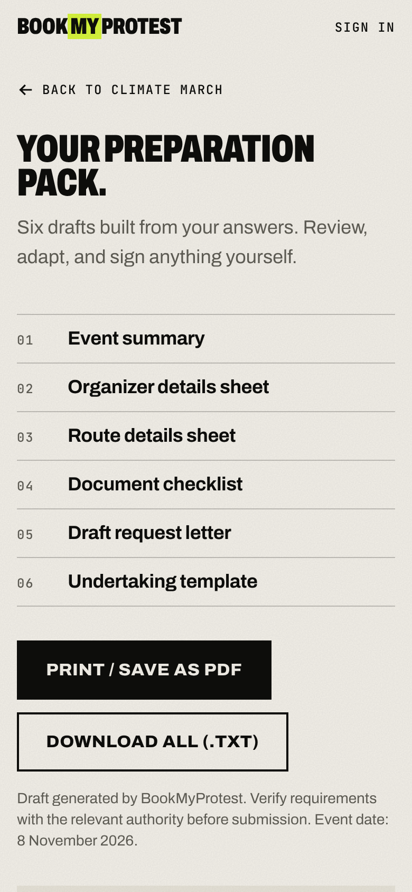 |
