# Preview v0.3.0 — rules platform

Screenshots from the real browser run of `scripts/e2e-admin.mjs` (production build, local, test data, **no real regulatory content**). Admin at 1280px, user screens at 390px. See [ARCHITECTURE-DELTA.md](../../ARCHITECTURE-DELTA.md).

| Step | Screenshot |
|---|---|
| Overview: unverified rules, pending reviews | 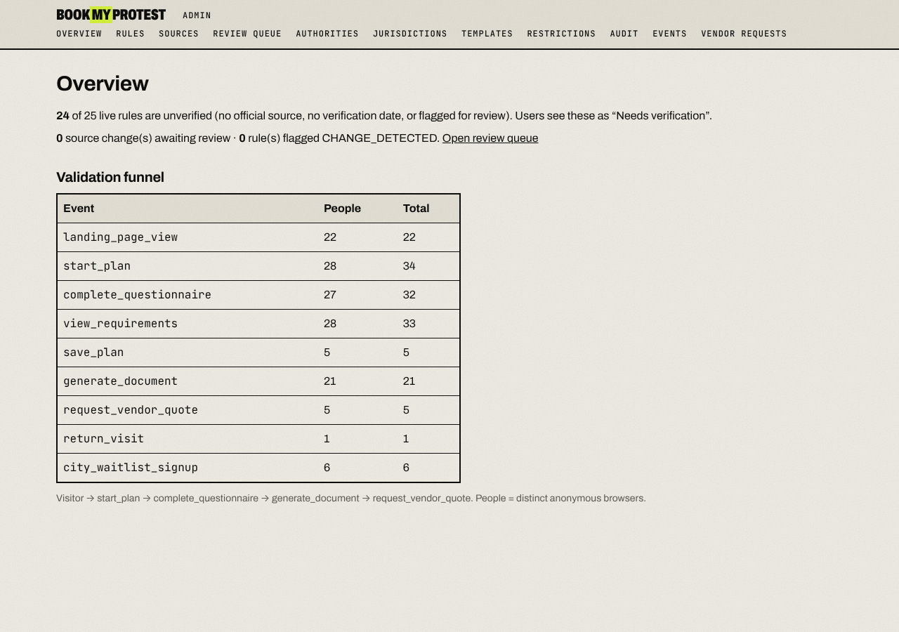 |
| 1. Jurisdictions (country › region › city) | 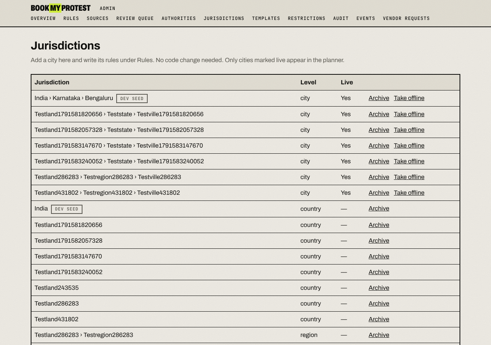 |
| 2. Authority as its own record | 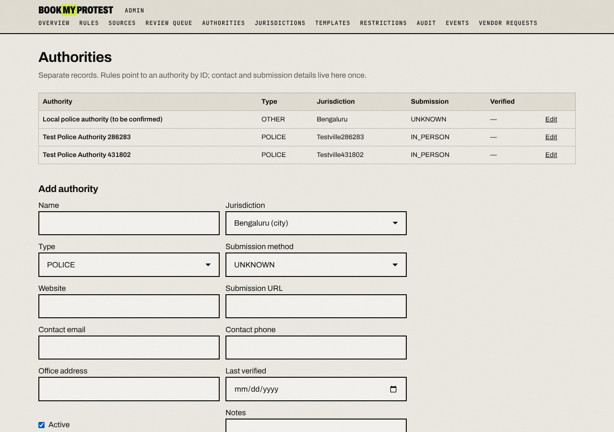 |
| 3. Official source with monitoring | 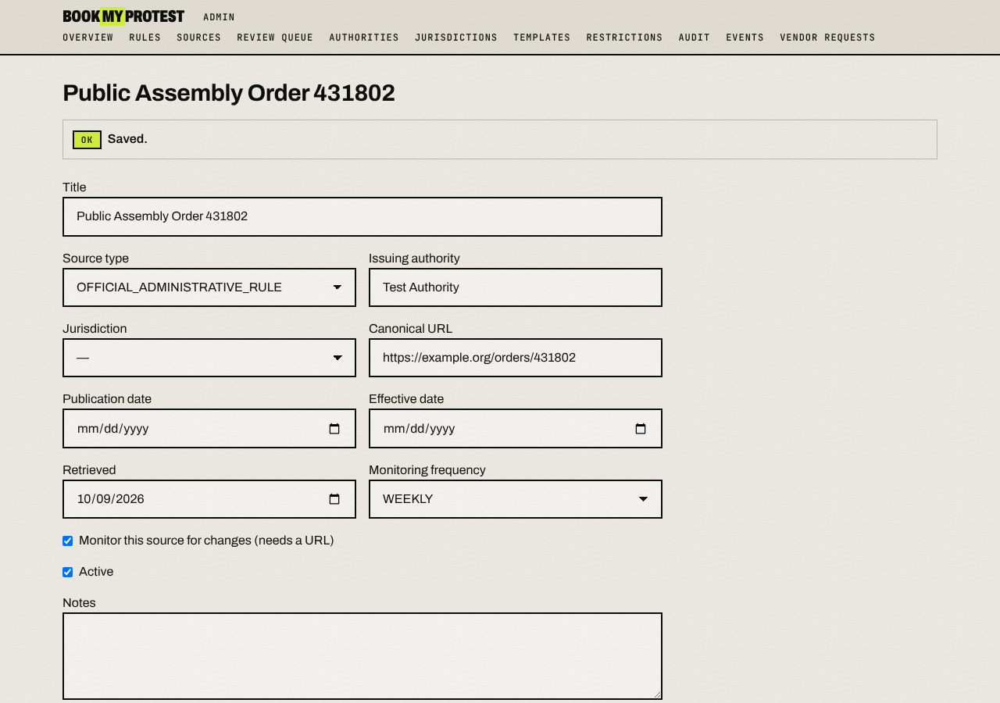 |
| 4–5. Rule draft + evidence | 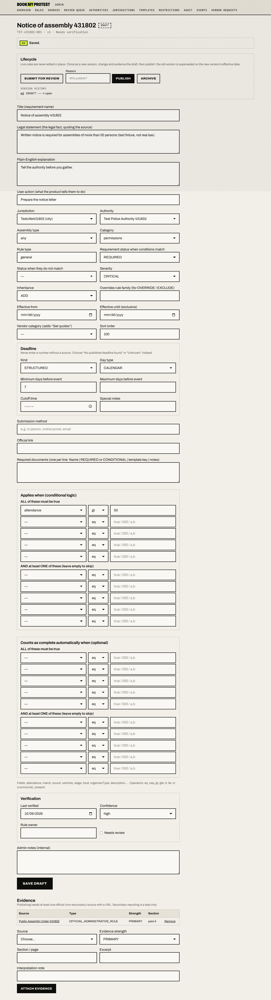 |
| 6. Published (ACTIVE) |  |
| 7–8. v2 published, v1 superseded, version history | 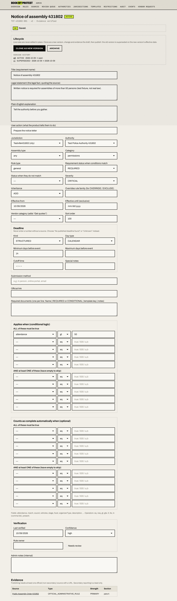 |
| Rules list with status and effective dates | 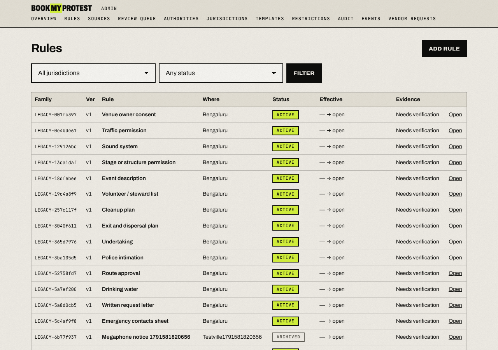 |
| 10–11. Source change in the review queue | 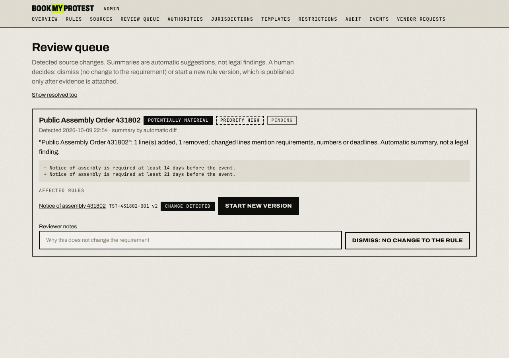 |
| 12. Approved update (resolved) | 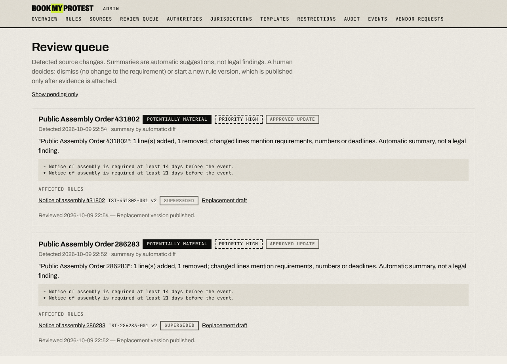 |
| 13. Template versions | 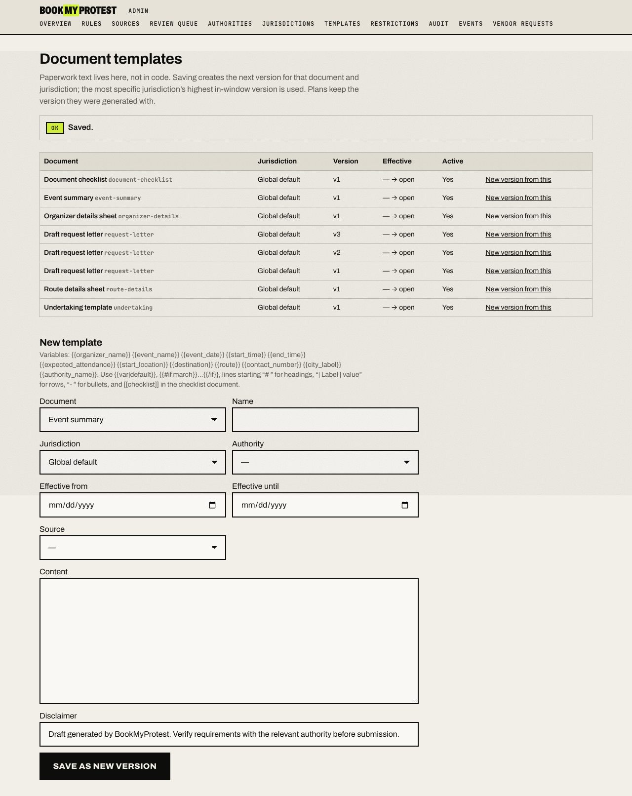 |
| Audit log | 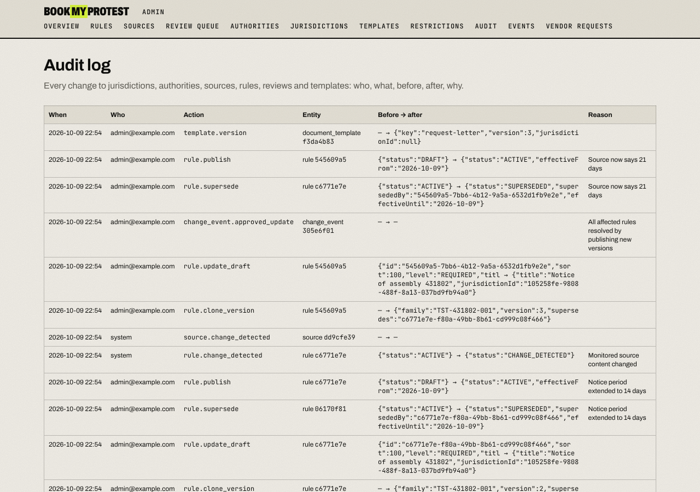 |
| User: rule Current, last verified | 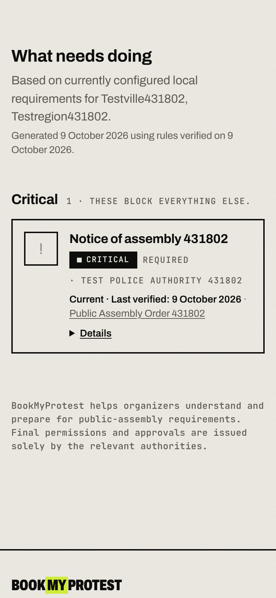 |
| User: rules changed since generation, Recheck | 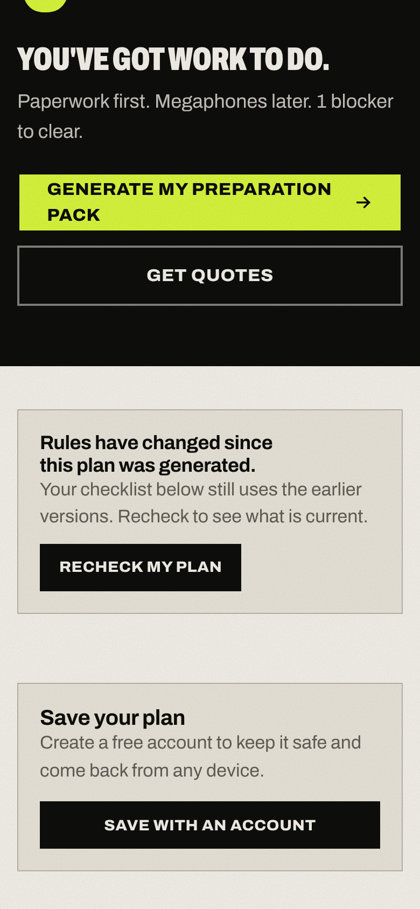 |
| User: change under review | 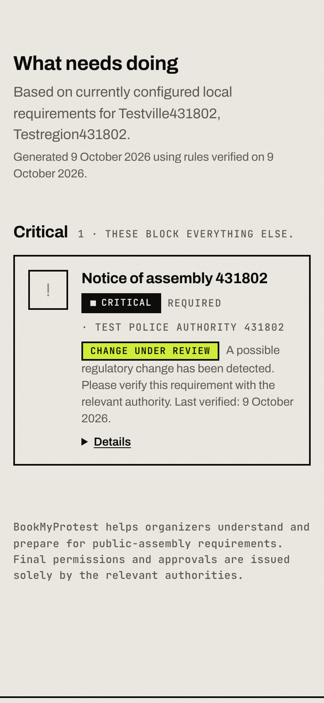 |
| User: pack generated from template v2 | 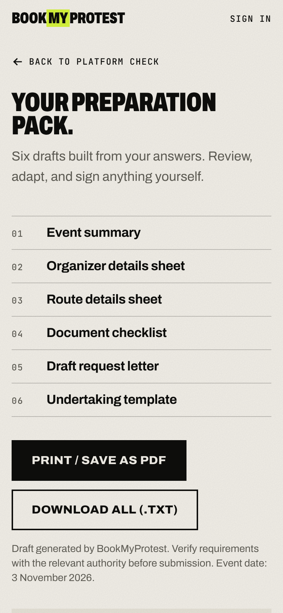 |
