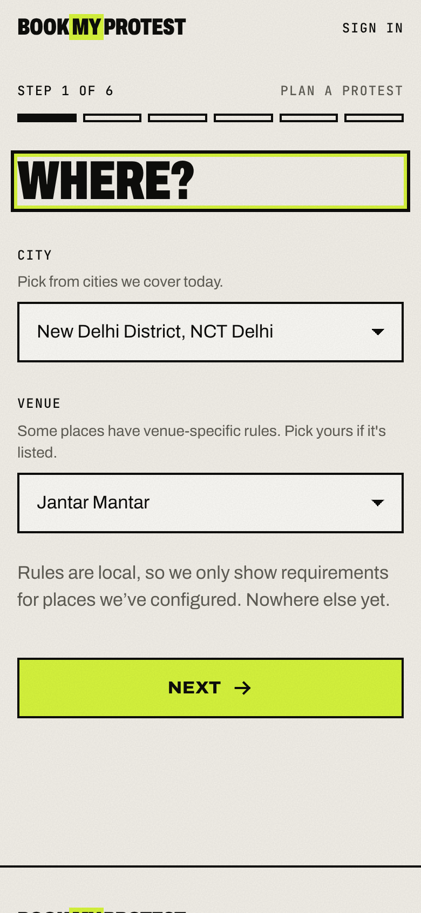
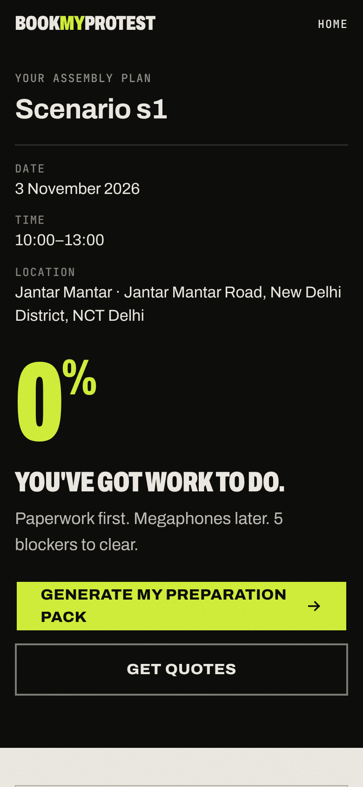
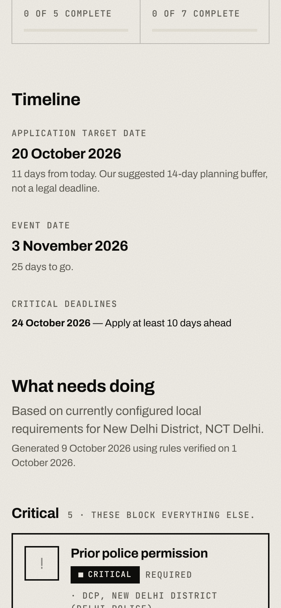
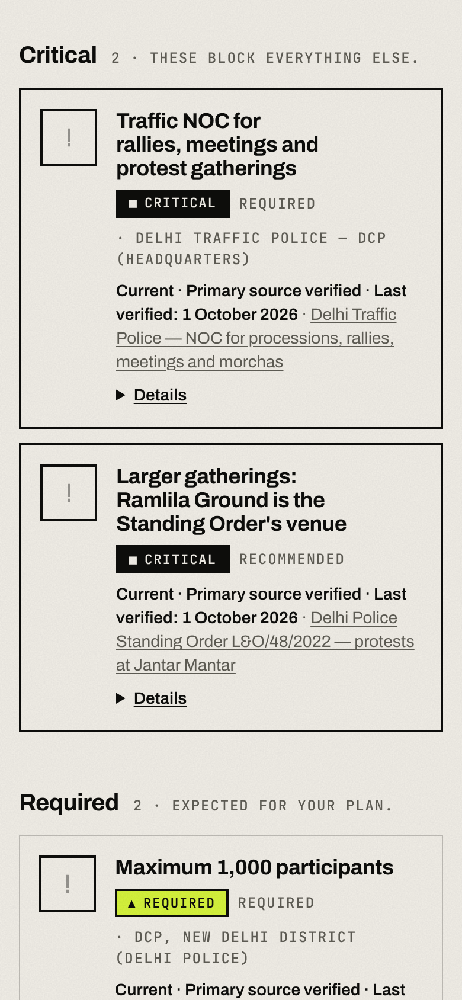
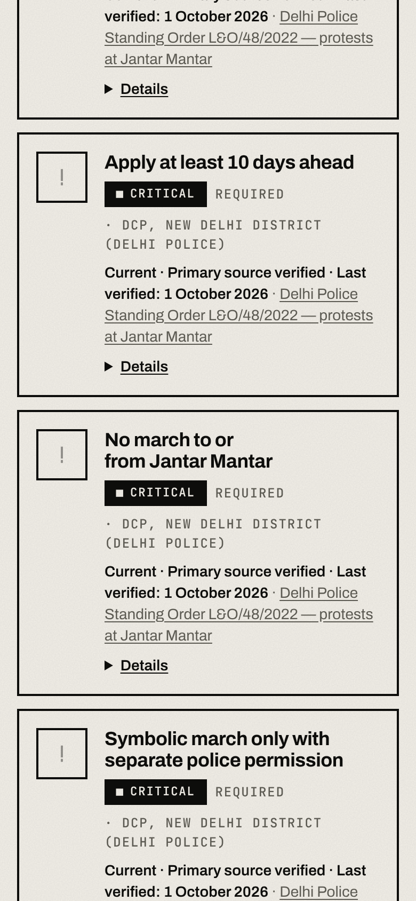
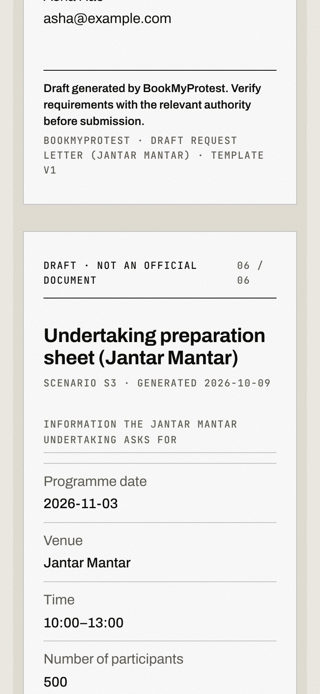

# Preview v0.4.0 — Delhi / Jantar Mantar scenarios

Real-browser screenshots (390px mobile, production build) from `scripts/e2e-delhi.mjs`, run against the **test database** where the corpus is fully loaded.

> **Test fixture:** the Standing Order source link visible on these screens (`example.org/test-fixture/…`) is a placeholder used only so the test database could publish. The real URL has not been supplied; in the dev database the Standing Order rules are still drafts. See [DELHI-JANTAR-MANTAR.md](../../DELHI-JANTAR-MANTAR.md).

| Screenshot | What it shows |
|---|---|
|  | Venue picker appears for New Delhi District |
|  | Scenario 1, 300-person static protest |
|  | Scenario 1, critical items |
|  | Scenario 2, 2,000 people: Ramlila routing guidance, cap shown |
|  | Scenario 3, 500 + march + loudspeaker: separate critical requirements |
|  | Venue-specific undertaking preparation sheet |
