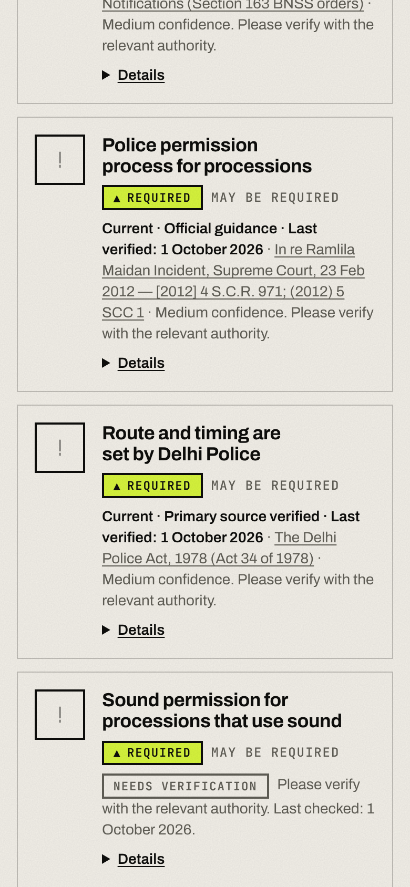
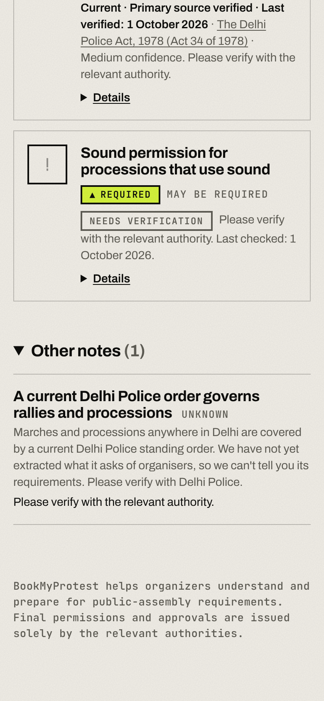

# Preview v0.6.0 — generic Delhi march baseline

Real-browser screenshots (390px, production build) from `scripts/e2e-delhi.mjs` against the **test database** (fully loaded; the Standing Order PDF link on those screens is the real official URL, but the test database was loaded with an explicit verification confirmation that has **not** been given for the dev database). See [DELHI-JANTAR-MANTAR.md](../../DELHI-JANTAR-MANTAR.md).

| Screenshot | What it shows |
|---|---|
|  | A 500-person march with sound outside Jantar Mantar: hedged permission process ("May be required"), route and timing from the Delhi Police Act, and the sound item honestly labelled **Needs verification**. No Jantar Mantar rule, no deadline. |
|  | The existence notice for the current Delhi Police order, shown as **unknown, please verify**, under "Other notes". |

The earlier Jantar Mantar scenario screenshots are in [v0.4.0](../v0.4.0/README.md).
